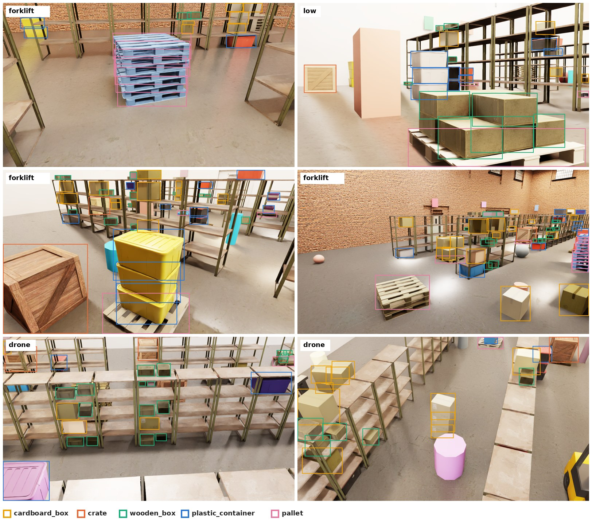
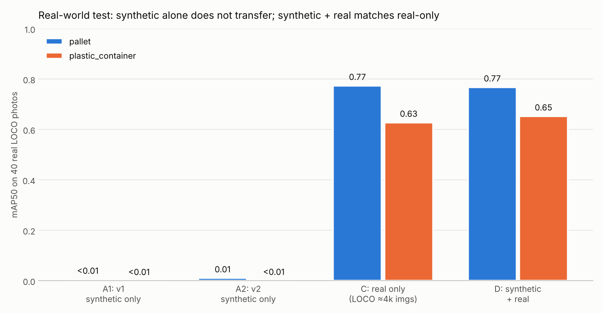
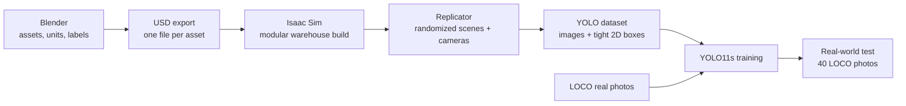
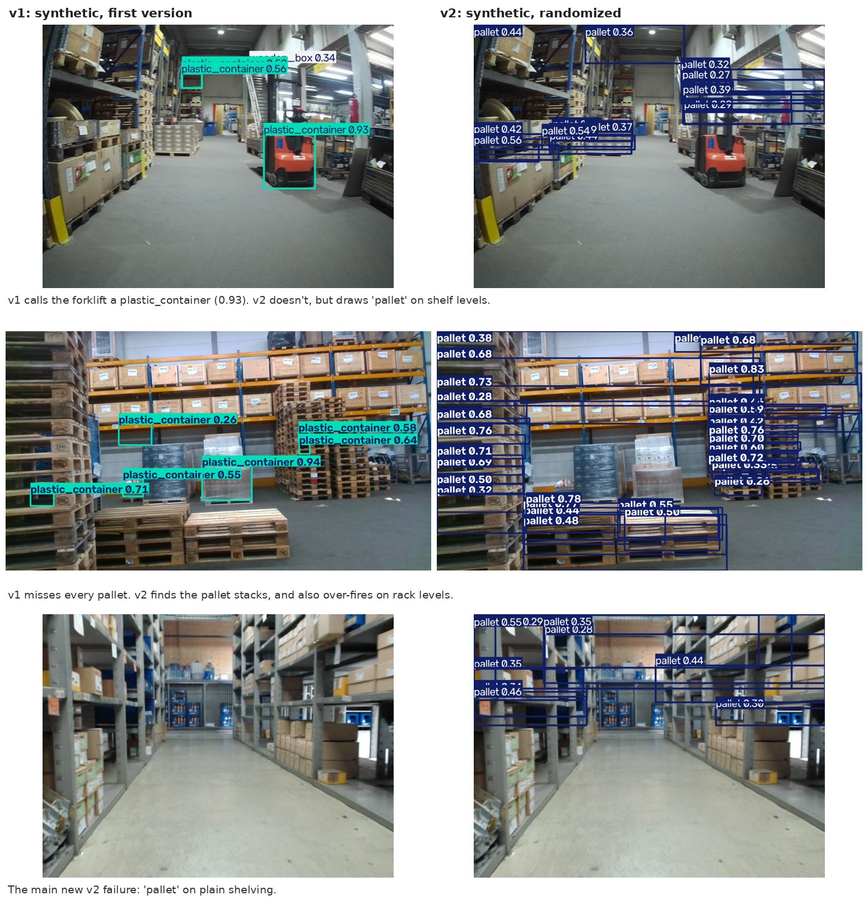

# Warehouse Synthetic Data with NVIDIA Isaac Sim — and an Honest Real-World Test

A procedural warehouse built in **NVIDIA Isaac Sim** that renders labeled training images for
**5 logistics object classes**, plus a real-world evaluation on the public **LOCO** warehouse dataset.

**The short version:** a detector trained *only* on synthetic images did not transfer to real
warehouse photos. Trained on **synthetic + real** images, it matched a real-only model on the real
test (mAP50 **0.710 vs 0.701**) while also covering **3 extra classes** that the real data does not label.


*Six v2 renders with their automatic labels: forklift-height, low and drone cameras.*

---

## Results at a glance

**Real-world test: 40 LOCO warehouse photos, 1,684 labeled boxes** (classes LOCO labels: pallet, plastic container)

| Model | Trained on | mAP50 | mAP50-95 | Pallet mAP50 | Container mAP50 | Precision |
|---|---|---|---|---|---|---|
| A1: synthetic v1 | 1,000 synthetic images | 0.003 | 0.001 | 0.005 | 0.000 | 0.05 |
| A2: synthetic v2 | 998 synthetic images | 0.006 | 0.002 | 0.011 | 0.001 | 0.02 |
| C: real only | ≈4,000 LOCO images | 0.701 | 0.327 | **0.774** | 0.628 | 0.73 |
| D: synthetic + real | v2 weights, fine-tuned on synthetic v2 + LOCO | **0.710** | **0.328** | 0.768 | **0.653** | **0.79** |



**On the synthetic validation sets** (held-out scenes from the same generator) the models scored
mAP50 0.974 (v1) and 0.943 (v2). Those numbers only show that the model learned the synthetic
world; the table above shows what happens on real photos.

---

## Pipeline



1. **Assets (Blender):** each asset checked for real-world size (meters, applied transforms,
   origin at bottom), its class stored as a custom property `semantic_class`, then exported to its
   **own** `.usdc` file. (Exporting the whole library into every file caused a 7,000-mesh scene and
   a GPU out-of-memory crash on a 10 GB card; one asset per file brought it down to about 300 meshes and 2.3 GB of VRAM.)
2. **Warehouse shell (Isaac Sim):** a 30 × 18 × 9 m building assembled by script on a 3 m grid:
   floor and roof tiles, modular facade walls with a loading door, a personnel door and windows,
   3 rows of shelving and ceiling lights. Every wall piece is measured and auto-aligned to its slot.
3. **Scene randomization (Replicator):** per scene, pallets (loaded and in empty stacks), floor
   stacks, shelf items, unlabeled distractors, lighting and walls are re-drawn from one seed;
   5 camera views per scene.
4. **Labels:** Replicator `bounding_box_2d_tight` with semantic classes, filtered (objects >70%
   occluded or <12 px dropped) and written in YOLO format.
5. **Split by scene,** not by image, so near-identical views never sit on both sides of train/val.

---

## The dataset

**Classes:** `cardboard_box`, `crate`, `wooden_box`, `plastic_container`, `pallet`

| | v1 | v2 |
|---|---|---|
| Images | 1,000 (200 scenes × 5 views) | 998 (2 blank frames auto-skipped) |
| Labeled boxes | 18,893 | 21,059 |
| cardboard_box / crate / wooden_box | 5,147 / 1,503 / 7,594 | 6,286 / 1,520 / 7,044 |
| plastic_container / pallet | 3,648 / 1,001 | 3,637 / **2,572** |
| Cameras | forklift height, drone | **low (0.4–1.2 m, wide lens)** 417, forklift 315, drone 266 |
| Resolution | 1280 × 720 | 1280 × 720 |
| Render time (RTX 3080) | — | about 10 min for 1,000 images |

### What changed from v1 to v2, and why

v1 was tested on real photos first. It found **zero pallets and zero crates** and fired on
forklifts, ceiling lights, windows and empty floor. The review pointed to four causes, each fixed in v2:

| Problem seen on real photos | v2 change |
|---|---|
| Synthetic scenes too dark; model learned "dark rectangle = object" | Ceiling lights ~2× brighter, stronger sky light, 2–6 random fill lights per scene |
| One texture per class; model learned *that* box, not boxes | Per-object appearance: tinted copies of each material (texture detail kept), flat colors; loads on a pallet share one look |
| Pallets only seen from above | Low wide-angle camera mode + stacks of 2–10 empty pallets |
| Red brick in every scene; real warehouses are grey/white | Walls repainted grey/white/beige in 65% of scenes |
| Fires on any box-shaped thing | Unlabeled distractors: cabinets, drums, cable rolls, wall signs, forklifts, barrels, generators |


*v2 found real pallets that v1 never detected, but introduced a new failure: "pallet" on shelf levels.*

---

## Real-world evaluation protocol

- **Test set:** 40 photos from **LOCO** (Logistics Objects in Context, CC0) with their original
  labels: 1,350 pallets and 334 small load carriers. Two of 42 hand-picked photos had no LOCO
  labels and were excluded.
- **Class mapping:** LOCO `pallet` → `pallet`; LOCO `small_load_carrier` → `plastic_container`.
  Stillages, forklifts and pallet trucks are not used. Only these two classes can be scored on LOCO.
- **No leakage:** LOCO images are video frames, so the 15 frames before and after each test photo
  were removed from all training and validation data.
- **Training (Ultralytics 8.4.194, YOLO11s, imgsz 960, batch 8, RTX 3080):**
  - A1/A2: 80 epochs on synthetic data from COCO weights (v2 with stronger HSV color augmentation)
  - C: 60 epochs on LOCO only from COCO weights
  - D: 40 epochs from the v2 weights on synthetic v2 + LOCO together (lr0 0.002). Mixing keeps the
    synthetic-only classes alive: LOCO photos contain many unlabeled cardboard boxes that would
    otherwise be learned as background.

---

## What I learned

1. **Synthetic-only did not transfer here (mAP50 < 0.01).** Two reasons, and only the first is the generator's fault:
   - *Domain gap:* the synthetic pallets and bins still look and sit differently from real ones.
   - *Label definitions:* LOCO labels ~35 pallets per photo, including tiny ones far down the
     aisle, while the generator drops boxes under 12 px. LOCO's "small load carrier" is a small blue
     stacking crate; the synthetic `plastic_container` is a large lidded storage box.
2. **Domain randomization helped where the real-photo review predicted.** v2 found real
   pallet stacks that v1 never detected, and v1's nonsense hits disappeared. It also created a new
   failure (pallet on shelf levels), visible only because the model was tested on real photos.
3. **With about 4,000 real images, synthetic data did not raise accuracy, and did not hurt it.**
   D and C are within noise on 40 photos (0.710 vs 0.701 mAP50; D more precise, C slightly better
   on pallets). D's real advantage is coverage: one model, 5 classes.
4. **The synthetic validation score is not evidence.** 0.97 mAP50 on synthetic data sat next to
   0.003 on real photos. Every claim in this report comes from the real test.

## Limitations

- The real test is small (40 photos) and only scores 2 of 5 classes.
- No real labeled test data yet for cardboard boxes, crates and wooden boxes.
- One building layout family; one model per class (variety comes from materials, scale and placement).

## Next steps

- **Low-data experiment:** train C and D on only ~100 real images. That is where synthetic
  pretraining is most likely to matter, and the situation most teams are in.
- **Generator v3:** pallet racking with beams, wire-mesh cages and layered shrink-wrapped goods as
  unlabeled decoys, size variation for cardboard boxes, and a small blue stacking crate model to match LOCO.
- A labeled real test set for the other 3 classes.

---

## Reproduce

| Script | Runs in | Does |
|---|---|---|
| `scripts/export_assets_usd_v2.py` | Blender | Labels the 5 classes and exports each asset to its own `.usdc`, verifying mesh counts |
| `scripts/build_warehouse.py` | Isaac Sim Script Editor | Builds the warehouse shell from the USD assets (seeded) |
| `scripts/generate_dataset.py` | Isaac Sim Script Editor | Randomizes scenes and renders images + YOLO labels + `metadata.json` |
| `scripts/split_dataset.py` | Python | Train/val split by scene, with label and leftover-file checks |
| `scripts/draw_labels.py` | Python | Draws labels on images for visual checking |
| `scripts/prepare_loco.py` | Python | Converts LOCO to YOLO, builds the leak-free real test set and experiment YAMLs |

```bash
# 1. Blender: run export_assets_usd_v2.py           -> usd_assets/*.usdc
# 2. Isaac Sim: run build_warehouse.py, then generate_dataset.py
python split_dataset.py OutIsaac_v2
yolo detect train data=OutIsaac_v2/data.yaml model=yolo11s.pt imgsz=960 epochs=80 batch=8 hsv_h=0.03 hsv_s=0.8 hsv_v=0.6
# 3. Real-world test
python prepare_loco.py --loco-json loco-main/rgb/loco-all-v1.json --loco-images loco-main/dataset --test-dir realphoto --out loco_prepared
yolo val model=<best.pt> data=loco_prepared/data_test.yaml split=test imgsz=960
```

Every dataset run writes a `metadata.json` (seed, settings, class counts, camera modes, Isaac Sim
version), so any image can be regenerated exactly from its seed.

---

## Credits and licenses

| Item | Source | License |
|---|---|---|
| Real test and training photos | LOCO, Mayershofer et al., ICMLA 2020 | CC0 1.0 |
| Modular factory facade (walls, doors, windows) | Poly Haven | CC0 |
| Plastic container, worn metal rack | Poly Haven | CC0 |
| Cardboard box, big crate, wooden box, pallet | ⚠ fill in source | ⚠ verify before publishing |
| Forklift, barrel, portable generator | ⚠ fill in source | ⚠ verify before publishing |
| Floor and roof tiles, scripts | Moinul Islam | — |

Rendered with NVIDIA Isaac Sim. The scene uses no NVIDIA sample assets; renders are outputs of the software.

> Mayershofer, C., Holm, D.-M., Molter, B., Fottner, J. *LOCO: Logistics Objects in Context.*
> IEEE International Conference on Machine Learning and Applications (ICMLA), 2020.

## Author

**Moinul Islam** — 3D animator moving into synthetic data for computer vision.
I build synthetic datasets in Isaac Sim, Blender and Unreal, and test them against real photos.

- GitHub: [moin77](https://github.com/moin77)
- LinkedIn: [moinulislammoin](https://www.linkedin.com/in/moinulislammoin)
- Upwork: [profile](https://www.upwork.com/freelancers/~01f6c51f7c6576ba03) · Fiverr: droper77
